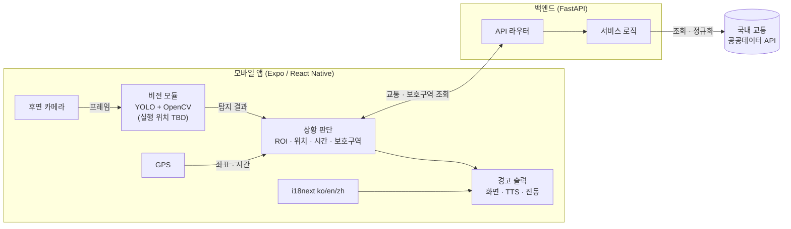
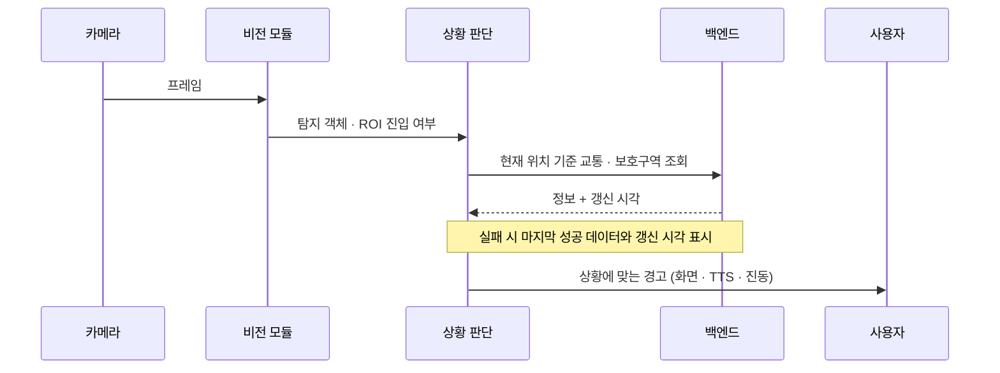

# 시스템 구조

초안. 확정되지 않은 항목은 `TBD`. 확정되면 갱신한다.

## 1. 구성 요소

| 구성 요소 | 기술 | 역할 |
|---|---|---|
| 모바일 앱 | React Native, Expo, Expo Router, TypeScript | 카메라 입력, 경고 표시(화면·TTS·진동), 다국어 UI |
| 웹 데모 | Expo Web, Vercel | 앱의 웹 시연 버전. 카메라·센서 제약은 TBD |
| 비전 모듈 | YOLO, OpenCV | 객체 탐지, ROI 판정. 실행 위치(기기/서버)는 TBD |
| 백엔드 | Python, FastAPI, Pydantic | 교통 정보 제공, 경고 컨텍스트 계산, (P1) 관측 이벤트 수집 |
| 교통 데이터 | 국내 교통 공공데이터 API | 정체·공사·통제, 보호구역. 구체 API는 TBD |
| 위치 | GPS | 현재 위치 → 보호구역·교통 정보 조회 |

## 2. 전체 구조

카메라 원본 영상은 서버로 보내지 않는다. 서버로 가는 것은 위치 기반 조회 요청과 (P1) 동의한 사용자의 경고 관측 이벤트뿐이다.

## 3. 경고 흐름

## 4. 설계 원칙

- 경고는 "위험 가능성" 표현만 쓰고 사고·충돌을 확정하지 않는다.
- 네트워크가 끊겨도 비전 기반 경고는 동작해야 한다. (가능 여부는 비전 모듈 실행 위치 결정에 따라 달라짐: TBD)
- 교통 데이터는 항상 "갱신 시각"과 함께 보여준다.
- 사용자 문구는 모두 i18next 키로 관리한다.

## 5. 미결정 사항 (TBD)

| 항목 | 선택지 | 비고 |
|---|---|---|
| YOLO 실행 위치 | 기기 내 / 서버 | 영상 비전송 원칙과 성능에 영향 |
| YOLO 모델·버전 | TBD | 7일 일정 내 가능한 규모로 |
| 교통 공공데이터 API | TBD | 호출 한도·이용 조건 확인 필요 |
| 백엔드 저장소(P1 이벤트 지도용) | 없음 / DB | [ERD](ERD.md) 참고 |
| 백엔드 저장소(로그인·즐겨찾기·최근목적지·자주가는경로) | SQLite + SQLModel로 결정 | [AUTH_DESIGN](AUTH_DESIGN.md) 참고 |
| 웹 데모 범위 | TBD | 카메라 접근 가능 범위 확인 필요 |
| 오디오 분류(P2) 방식 | TBD | |
