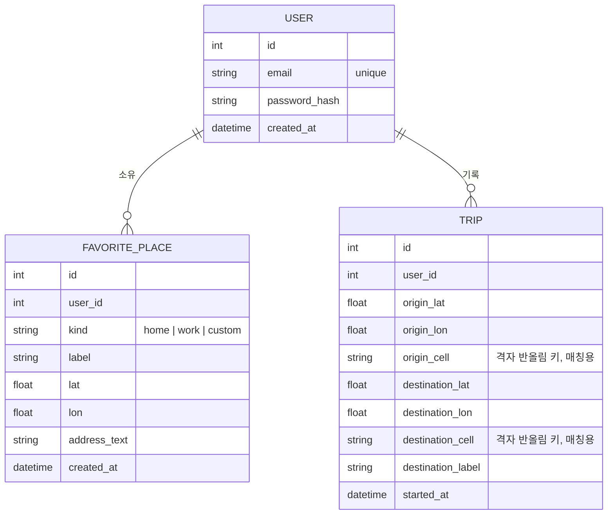
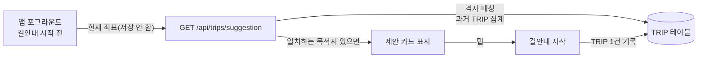
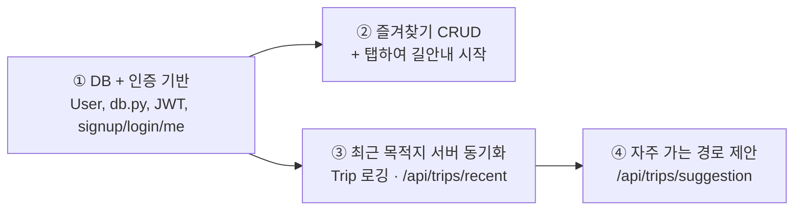

# 로그인·DB 설계 (Auth / Favorites / Trips)

초안. 확정되지 않은 항목은 `TBD`. 이 문서는 [ARCHITECTURE](ARCHITECTURE.md)·[ERD](ERD.md)·[REQUIREMENTS](REQUIREMENTS.md)를 보강한다. 지금까지 백엔드는 DB 없이 공공데이터를 그때그때 받아 정규화해 돌려주는 무상태 서버였다(`app/service.py`, `app/adapters.py`, `app/upstream.py`). 이 문서에서 처음으로 서버에 영구 저장소와 사용자 계정을 둔다.

## 1. 범위

| 범위 안 | 범위 밖 (이번에 안 만든다 / TBD) |
|---|---|
| 이메일+비밀번호 가입·로그인 | 소셜 로그인(카카오·구글 등) |
| 즐겨찾기(집/회사/커스텀) CRUD + 탭하여 길안내 시작 | 즐겨찾기 공유, 다중 사용자 공동 즐겨찾기 |
| 최근 목적지 서버 동기화(기기 간) | 과거 localStorage 데이터 자동 이전(마이그레이션 스크립트 TBD) |
| 자주 가는 경로 제안(포그라운드 전용) | 상시 백그라운드 위치 추적, 실시간 경로 이탈 재추천 |
| JWT 기반 인증 | 리프레시 토큰 로테이션, 다중 기기 세션 관리, 강제 로그아웃, 비밀번호 재설정 이메일 |

## 2. 결정 요약

| 항목 | 결정 | 근거 |
|---|---|---|
| DB | SQLite + SQLModel | 4번 참고 |
| 인증 | JWT(Bearer), 세션·쿠키 아님 | 3번 참고 |
| 비밀번호 해싱 | bcrypt | 단일 목적 라이브러리, 설정 고를 일이 없다 |
| 토큰 보관(클라이언트) | 네이티브: `expo-secure-store`(신규 의존성) / Expo Web: `localStorage`(기존 최근목적지와 같은 패턴) | 플랫폼별 분기만 있으면 됨, 새 상태관리 라이브러리 불필요 |
| "자주 가는 경로" 판단 데이터 | 매 이동 GPS 전체가 아니라, 길안내 시작 시점의 출발지·목적지·시각 1건만 저장 | 5-3번 참고 |

## 3. 인증 방식

### 세션(쿠키) vs JWT

| | 세션·쿠키 | JWT(Bearer 토큰) |
|---|---|---|
| 서버 상태 | 필요(세션 저장소) | 없음(서명만 검증) |
| Expo(RN) 적합성 | `fetch`가 쿠키를 자동으로 들고 다니지 않아 별도 쿠키 라이브러리 필요. Web/Native 동작이 갈린다 | `Authorization: Bearer <token>` 헤더로 RN·Expo Web 동일하게 동작 |
| 로그아웃 | 서버에서 세션 폐기 가능 | 클라이언트가 토큰을 지우는 것뿐. 서버가 강제 폐기하려면 블랙리스트 등 추가 상태 필요(TBD, 이번엔 안 함) |

→ **JWT**를 선택한다. RN+Expo Web 두 클라이언트를 같은 방식으로 다뤄야 하는 게 결정적이다.

- 라이브러리: `PyJWT`(`import jwt`). ~~`python-jose`~~는 FastAPI 공식 문서도 더 이상 권장하지 않는다(유지보수 상태 이슈).
- 알고리즘: HS256. 비밀키는 기존 `app/config.py`의 `Settings`에 `jwt_secret: SecretStr`로 추가(다른 키처럼 `.env`로만 관리, 로그·응답에 노출 금지 — N-03·N-04).
- 클레임: `sub`(user id, 정수/문자열), `exp`뿐. 이메일 등 식별정보는 토큰에 담지 않는다.
- 만료: 제안 14일, 리프레시 토큰 없음. **알려진 한계**: 탈취되면 만료까지 유효하고, 서버가 즉시 무효화할 방법이 없다. 7일 일정·소규모 사용자 전제의 의도적 단순화다. 사용자 수가 늘거나 민감정보가 늘면 리프레시 토큰+폐기 목록으로 올려야 한다.
- 비로그인 사용자가 로그인 전용 기능(즐겨찾기 탭, 저장 등)을 누르면: 그 버튼은 토큰이 없을 때 로그인 화면으로 보내는 게 **프런트엔드** 책임이다(가드는 화면 전환, 서버는 토큰 없으면 401만 내려준다). 서버에 "옵셔널 인증" 분기를 만들지 않는다.

### 비밀번호 해싱

`bcrypt` 직접 사용(cost factor 12). `passlib`은 더 이상 활발히 유지되지 않고, FastAPI 최신 문서는 `pwdlib`(argon2)를 쓰지만 그러면 의존성이 하나 더 늘어난다. 이 프로젝트 규모에서는 `bcrypt` 하나로 충분하다.

## 4. DB 선택

**SQLite + SQLModel**을 제안한다.

| 후보 | 비고 |
|---|---|
| **SQLModel + SQLite** (제안) | SQLAlchemy + Pydantic을 합친 것(FastAPI 제작자가 만듦, FastAPI 공식 튜토리얼이 SQL 데이터베이스 예제로 쓰는 방식). 이 코드베이스가 이미 Pydantic으로 요청·응답을 정의하는 스타일이라 학습 비용이 적다. 서버 프로세스·설치 없이 파일 하나(`backend/app/data/tikkeul.db`, `.gitignore` 대상)로 끝난다 |
| 순수 `sqlite3` + 수동 SQL | 의존성은 더 적지만, 스키마·쿼리를 손으로 다 짜야 해서 SQLModel보다 코드가 더 많아진다. 7일 안에는 SQLModel이 더 빠르다 |
| PostgreSQL | 별도 DB 서버·연결 정보 관리가 필요하다. 사용자 수가 적은 7일 프로젝트에 지금 당장은 과한 선택 |

- 동시 쓰기: SQLite는 쓰기 잠금이 파일 단위다. 이 프로젝트 사용자 수·쓰기 빈도(가입·즐겨찾기·길안내 시작)에서는 문제가 되지 않는다.
- 접근 방식: FastAPI 공식 패턴대로 동기(sync) `Session`을 라우터에 `Depends`로 주입한다. `def` 라우터(비동기 아님)로 두면 FastAPI가 스레드풀에서 돌려 이벤트 루프(ITS 등 외부 API `httpx` 호출)를 막지 않는다.
- **배포 리스크(확인 필요, TBD)**: `main.py`의 `/health` 주석(`Render 상태 확인`)으로 보면 Render 배포를 염두에 둔 것으로 보인다. Render 무료/스타터 티어는 재배포·재시작 시 디스크가 초기화될 수 있다. SQLite 파일을 그대로 쓰려면 **영구 디스크(Persistent Disk)** 옵션이 필요하다. 안 되면 대안은 Render의 관리형 Postgres로 바꾸는 것뿐이며, SQLModel을 쓰면 연결 문자열만 바꾸면 되므로 전환 비용은 작다. **배포 전에 반드시 확인.**

## 5. 스키마



### 5-1. 왜 테이블이 3개뿐인가

"최근 목적지"를 위한 별도 테이블을 두지 않는다. `TRIP`에 길안내를 시작할 때마다 한 줄만 쌓고, **최근 목적지**와 **자주 가는 경로 제안**을 둘 다 이 한 테이블에서 읽는다(중복 저장 없음).

- 최근 목적지 = `TRIP`에서 `user_id` 기준으로 `destination`별 최신 `started_at`을 모아 최근 N개
- 자주 가는 경로 제안 = `TRIP`에서 같은 `origin_cell` → `destination_cell` 조합이 반복되는지 집계

### 5-2. FavoritePlace

| 필드 | 설명 |
|---|---|
| `kind` | `home` / `work` / `custom`. `home`·`work`는 사용자당 하나만(앱 로직에서 검사 — DB 제약은 걸지 않는다. 이미 있으면 생성 API가 409를 돌려주고 PATCH로 바꾸게 한다) |
| `label` | 화면에 보일 이름("집", "회사", 커스텀이면 사용자가 지은 이름) |
| `address_text` | 역지오코딩 결과 등 표시용 주소(선택) |

### 5-3. "자주 가는 경로" 판단 — 최소 데이터로 충분한지

**충분하다.** 매번 전체 GPS 궤적을 저장할 필요는 없다. 저장하는 건 **길안내를 실제로 시작한 순간**의 출발지·목적지·시각, 1건뿐이다(경로 중간 좌표는 저장하지 않는다). 이것으로:

1. **반복 판정이 된다** — "자주 가는 경로"는 출발 지점과 목적지가 반복되는 것이고, 중간 경로가 매번 똑같은지는 중요하지 않다(교통상황 따라 길이 달라져도 출발·도착이 같으면 같은 "경로"로 본다).
2. **좌표를 그대로 비교하지 않는다** — GPS는 매번 미세하게 다르므로, 저장 시 `origin_lat/lon`·`destination_lat/lon`을 소수 3자리로 반올림한 `origin_cell`/`destination_cell` 문자열("37.566,126.978")을 같이 저장해 그 값으로 그룹핑한다. 약 100m 격자다. 이 두 컬럼에 인덱스를 둔다.
3. **판단 로직(개략)**: 현재 위치를 같은 방식으로 반올림한 뒤, `TRIP`에서 `user_id`+`origin_cell` 일치, `started_at`이 최근 30일 이내인 행을 `destination_cell`별로 묶어 세고, 3회 이상 반복된 목적지가 있으면 그걸 제안한다. 요일·시간대 가중치는 넣지 않는다(TBD: 데이터가 쌓이면 P2로 고려).
4. **보관 기간(TBD)**: 90일 지난 `TRIP`은 주기적으로 삭제하는 걸 제안한다(정확한 보관 기간은 TBD). N-02(위치정보 최소 수집) 원칙과도 맞는다.
5. **수집 시점**: GPS를 상시 추적하지 않는다. `TRIP`은 사용자가 **실제로 길안내를 시작**할 때만 한 줄 생긴다(검색 결과 선택, 최근목적지 탭, 즐겨찾기 탭, 제안 카드 탭 — 어디서 시작했든 동일). "제안"을 계산할 때 보내는 현재 위치는 저장하지 않고 그 요청에만 쓰고 버린다(비교 대상인 과거 `TRIP`만 DB에 있다).

### 5-4. 자주 가는 경로 제안 흐름



- 호출 주기는 상수 폴링이 아니라 "포그라운드 + 길안내 미시작" 상태에서 적당한 간격(제안: 30~60초 또는 일정 거리 이동마다)으로 프런트가 호출한다. 백그라운드 위치 추적은 쓰지 않는다(N-02, CLAUDE.md 원칙).

## 6. 기존 FastAPI 구조와의 통합

`app/navigation/`은 PoC를 그대로 복사해 들여온 별도 모듈이라 자체 `config.py`를 쓴다. Auth·Favorites·Trips는 새로 만드는 기능이므로 보존해야 할 PoC가 없고, 기존 `app/routers/` + `app/service.py` + `app/config.py` 패턴(라우터·서비스 분리, 공통 `Settings`)을 그대로 따른다.

```
backend/app/
├── config.py          # (수정) jwt_secret, jwt_algorithm, jwt_expires_days, database_url 추가
├── db.py              # (신규) SQLModel engine, get_session 의존성, create_db_and_tables()
├── auth/
│   ├── models.py       # User(SQLModel, table=True) + SignupRequest/LoginRequest/TokenResponse/UserPublic
│   ├── security.py     # bcrypt 해시·검증, PyJWT 발급·검증
│   ├── deps.py         # get_current_user(Depends) — 토큰 없거나 무효하면 401
│   └── router.py       # /api/auth/*
├── favorites/
│   ├── models.py       # FavoritePlace(SQLModel, table=True) + 요청/응답 모델
│   └── router.py       # /api/favorites/* (get_current_user 필수)
└── trips/
    ├── models.py        # Trip(SQLModel, table=True) + 요청/응답 모델
    ├── service.py        # 최근 목적지 조회, 격자 매칭 집계(자주 가는 경로) — 라우터와 분리
    └── router.py          # /api/trips/* (get_current_user 필수)
```

- `main.py`: `lifespan`에서 `create_db_and_tables()` 호출, `app.include_router(...)`로 3개 라우터 추가.
- **CORS 주의**: 지금 `main.py`의 `CORSMiddleware`는 `allow_methods=["GET", "POST"]`뿐이다. 즐겨찾기 수정/삭제에 `PATCH`·`DELETE`를 쓰므로 구현 시 여기에 추가해야 한다(안 하면 Expo Web에서 조용히 막힌다).

## 7. API 엔드포인트 목록 (개략)

| 메서드·경로 | 인증 | 요청 | 응답 |
|---|---|---|---|
| `POST /api/auth/signup` | 불필요 | `{email, password}` | `201` `{access_token, token_type, user: {id, email}}` / 이메일 중복 `409` |
| `POST /api/auth/login` | 불필요 | `{email, password}` | `200` `{access_token, token_type}` / 실패 `401` |
| `GET /api/auth/me` | 필요 | - | `{id, email, created_at}` |
| `GET /api/favorites` | 필요 | - | `[{id, kind, label, lat, lon, address_text}]` |
| `POST /api/favorites` | 필요 | `{kind, label, lat, lon, address_text?}` | `201` 생성됨 / `home`·`work` 중복 시 `409` |
| `PATCH /api/favorites/{id}` | 필요 | 바꿀 필드만 | 수정된 항목 |
| `DELETE /api/favorites/{id}` | 필요 | - | `204` |
| `POST /api/trips` | 필요 | `{origin:{lat,lon}, destination:{lat,lon,label,address_text?}}` | `201` `{id}` — 길안내를 실제로 시작할 때 호출 |
| `GET /api/trips/recent?limit=10` | 필요 | - | `[{label, lat, lon, address_text, last_used_at}]` |
| `GET /api/trips/suggestion?lat=&lon=` | 필요 | 쿼리 좌표(저장 안 됨) | `null` 또는 `{destination:{label,lat,lon}, count}` |

공통 규칙은 [API_SPEC](API_SPEC.md)을 따른다(JSON, ISO 8601, 에러 형식은 거기서 같이 정리).

## 8. 하위 작업 분리



- **①이 먼저다.** 나머지 전부가 인증(`get_current_user`)과 `db.py`에 의존한다.
- **②·③은 ① 이후 병렬로 가능하다.** 서로 다른 테이블(`FavoritePlace` vs `Trip`)을 건드리고 서로를 참조하지 않는다.
- **④는 ③ 이후다.** 제안 로직이 읽는 데이터(`TRIP`)를 ③이 만들기 때문이다. 게다가 ④는 데이터가 쌓여야("최소 3회 반복") 의미가 생기는 기능이라 자연스럽게 마지막 — 초기에는 항상 빈 결과를 돌려줄 것이고, 이건 버그가 아니라 정상이다(QA 시 유의).

## 9. 보안·개인정보 체크 (CLAUDE.md N-01~N-09 연결)

- 비밀번호는 평문으로 어디에도 남기지 않는다. 해시만 저장(N-04).
- `jwt_secret`은 `.env`로만 관리, 코드에 하드코딩하지 않는다(N-03).
- JWT 클레임에 이메일 등 개인정보를 넣지 않는다.
- `/api/trips/suggestion`에 보내는 현재 좌표는 응답 생성에만 쓰고 저장하지 않는다(N-02).
- `TRIP`에는 길안내를 시작한 사건만 쌓인다. 상시 위치 추적이 아니다(N-02).
- 로그에 이메일·좌표·토큰을 남기지 않는다(N-04) — `app/main.py`가 이미 `httpx`/`httpcore` 로그 레벨을 올려 URL 노출을 막은 것과 같은 원칙.

## 10. TBD

- Render(또는 다른 호스팅)에서 SQLite 파일의 영구 디스크 확보 여부 — 안 되면 Postgres로 전환
- JWT 만료 기간(14일 제안), 토큰 재발급/로그아웃 UX
- `TRIP` 보관 기간(90일 제안)
- "자주 가는 경로" 반복 기준 횟수(3회 제안)·요일/시간대 가중치 여부
- 기존 localStorage 최근목적지를 서버 데이터로 1회 이전할지 여부(이전 안 하면 로그인 시 서버 쪽은 빈 목록으로 시작)
- 비밀번호 재설정, 이메일 인증 여부
