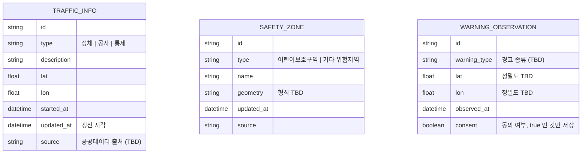

# 논리 데이터 모델

초안. 백엔드에 DB를 둘지 여부 자체가 **TBD**다. P0 기능은 외부 교통 데이터를 조회·정규화해 전달하는 구조라 영구 저장소가 필수인지 확정되지 않았다. 저장이 필요해지는 대표 사례는 P1 "동의 기반 경고 관측 이벤트 지도"다.

아래 엔티티는 요구사항에서 도출한 후보이며, 필드는 확정 전 변경될 수 있다.

## 엔티티 설명

| 엔티티 | 관련 요구사항 | 저장 여부 |
|---|---|---|
| TRAFFIC_INFO | F-04 | 캐시 정도만 필요할 수 있음 (TBD) |
| SAFETY_ZONE | F-05 | 정적 데이터면 파일/캐시로 충분할 수 있음 (TBD) |
| WARNING_OBSERVATION | F-09 (P1) | 저장 필요. 동의한 사용자의 것만 |

## 원칙

- 사용자 식별자와 연결되는 위치 이력을 저장하지 않는다. 관측 이벤트는 사용자와 분리한다 (구체 방식 TBD).
- 위치 좌표는 필요한 정밀도로만 저장한다.
- 카메라 영상·프레임은 저장하지 않는다.
- `WARNING_OBSERVATION`은 "경고가 발생했다"는 관측이지 사고 발생 기록이 아니다.

## TBD

- DB 사용 여부와 종류
- 관측 이벤트 보관 기간·삭제 정책
- 이벤트 위치의 익명화·정밀도 처리 방식

## 참고

로그인 사용자용 데이터(User·FavoritePlace·Trip)는 이 문서의 범위가 아니다. [AUTH_DESIGN](AUTH_DESIGN.md)에서 별도로 다룬다.
